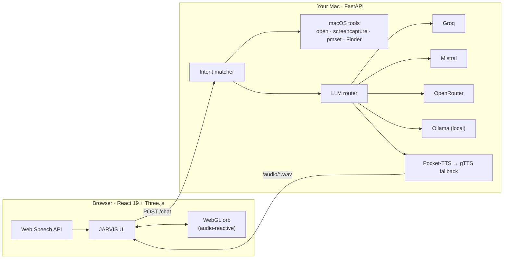

<div align="center">


# JARVIS

**Talk to your Mac. It talks back, and gets things done.**

A voice-first AI assistant with a living 3D interface. Hold <kbd>Space</kbd>, speak, and JARVIS answers in a cloned voice while it opens apps, manages files and checks on your system. The brain runs on your own machine.

<p>
  <a href="https://jarvis-ai-hud-one.vercel.app"></a>
  
  
  
  
</p>

<a href="https://jarvis-ai-hud-one.vercel.app"><b>Live UI</b></a> ·
<a href="#-quick-start"><b>Quick start</b></a> ·
<a href="#-what-it-can-do"><b>Commands</b></a> ·
<a href="#-how-it-works"><b>How it works</b></a> ·
<a href="#-configuration"><b>Configuration</b></a>

<br /><br />


</div>

---

## ✨ Why JARVIS

- 🎙 **Voice first, hands free.** Hold-to-talk, tap-to-toggle or continuous conversation. The orb reacts to your voice in real time and stops talking the moment you start.
- 🧠 **Never stuck on one model.** Routes across Groq, Mistral and OpenRouter, and falls back to fully local Ollama when you're offline.
- 🗣 **Sounds like JARVIS.** Kyutai Pocket-TTS clones a voice from a few seconds of reference audio, with gTTS as an automatic fallback.
- ⚙️ **Actually does things.** Opens apps and sites, reads, writes and lists files, takes screenshots and reports battery, CPU and memory.
- 🛡 **Careful by design.** Deletions go to the Trash, never `rm`, only inside Desktop, Documents and Downloads. Remote actions are off by default.
- 🌗 **A studio-grade interface.** Glossy WebGL orb, oversized type, light and dark themes, and a layout that works from phone to ultrawide.

## 🖼 Interface

<picture>
  <source media="(prefers-color-scheme: dark)" srcset="assets/screenshots/hero-dark.png" />
  
</picture>

<table>
  <tr>
    <td width="50%"></td>
    <td width="50%"></td>
  </tr>
  <tr>
    <td align="center"><b>Conversation</b>: the latest reply set large, with what JARVIS just did underneath</td>
    <td align="center"><b>Systems</b>: providers, live audio spectrum and a terminal of everything happening</td>
  </tr>
  <tr>
    <td width="50%"></td>
    <td width="50%"></td>
  </tr>
  <tr>
    <td align="center"><b>Settings</b>: pick a provider and model, voice, hotkey, API keys and backend URL</td>
    <td align="center"><b>Menu</b>: oversized navigation, closes with <kbd>Esc</kbd></td>
  </tr>
</table>

<p align="center">
  
  &nbsp;
  
</p>

> [!NOTE]
> The replies in these screenshots come from a scripted stand-in backend, so the capture wouldn't open real apps or need API keys. Everything else is the real UI.

## 🚀 Quick start

**You'll need:** macOS, Python 3.10+ (`brew install python@3.12`), Node 20+ and Chrome or Edge (for the Web Speech API).

```bash
git clone https://github.com/JayDev-27/Jarvis.git
```

```bash
cd Jarvis && ./start.sh
```

`start.sh` finds a Python 3.10+ interpreter, creates `backend/.venv`, installs dependencies, copies `backend/.env.example` to `backend/.env`, then starts FastAPI on `:8000` and Vite on `:5173`. <kbd>Ctrl</kbd>+<kbd>C</kbd> stops both.

Open **http://localhost:5173**, add at least one API key under **Menu → Settings → API keys** (or run [Ollama](https://ollama.com) locally), and hold <kbd>Space</kbd>.

<details>
<summary><b>Use the hosted UI instead of running Vite</b></summary>

The interface is deployed at **https://jarvis-ai-hud-one.vercel.app**. It still talks to the backend on *your* Mac at `http://127.0.0.1:8000`, so nothing you say goes to Vercel.

1. Make sure `backend/.env` contains `JARVIS_ALLOWED_ORIGINS=https://jarvis-ai-hud-one.vercel.app` (it's in `.env.example`).
2. Start the backend (`./start.sh`, or the manual steps below).
3. Open the live UI and allow local network access if your browser asks.

A different backend address can be set under **Settings → Connection**.
</details>

<details>
<summary><b>Manual setup</b></summary>

```bash
cd backend
python3.12 -m venv .venv && source .venv/bin/activate
pip install -r requirements.txt
cp .env.example .env
uvicorn app.main:app --reload --port 8000
```

```bash
cd frontend
npm install
npm run dev
```
</details>

## 💬 What it can do

| Say or type | What happens |
|:--|:--|
| *"Open Spotify"*, *"Launch Terminal"* | Launches the app with `open -a` |
| *"Open github.com"*, *"Open YouTube"* | Opens the site in your default browser |
| *"Create file notes.txt"*, *"Make folder Projects"* | Creates it on your Desktop (or the path you name) |
| *"Write 'hello' to notes.txt"* | Writes or appends; can draft the content with the LLM |
| *"Read file notes.txt"*, *"What's in Downloads?"* | Reads files and lists folders |
| *"Delete file old.txt"* | Moves it to the **Trash**, only inside Desktop, Documents or Downloads |
| *"Take a screenshot"* | Saves a timestamped PNG to your Desktop |
| *"Check battery"*, *"Show memory usage"* | Reports battery, CPU and memory |
| Anything else | A normal conversation, with the last 20 turns as context |

### Controls

| Action | How |
|:--|:--|
| Push to talk | Hold <kbd>Space</kbd> (change it in Settings, e.g. `Meta+J`) |
| Toggle mic | Click the blue mic in the composer, or **Talk** in the header |
| Type instead | Use the composer at the bottom of the screen |
| Continuous conversation | Settings → General → *Continuous conversation* |
| Theme | The sun/moon button in the header (remembered per browser) |

## 🧩 How it works



1. The browser transcribes your speech and sends it to `POST /chat`.
2. The backend first checks whether you asked for a system action and runs it.
3. The LLM router answers, including the action's result, trying providers in order until one responds.
4. The reply is synthesised to audio, and the UI plays it back while the orb follows the voice.

## ⚙️ Configuration

Everything lives in `backend/.env`. API keys can also be saved from **Settings → API keys**, which writes them to that same file.

| Variable | Purpose |
|:--|:--|
| `GROQ_API_KEY`, `GROQ_MODEL` | Groq (tried first) |
| `MISTRAL_API_KEY`, `MISTRAL_MODEL` | Mistral |
| `OPENROUTER_API_KEY`, `OPENROUTER_MODEL` | OpenRouter |
| `OLLAMA_MODEL`, `OLLAMA_SECOND_MODEL` | Local models at `localhost:11434` |
| `HUGGINGFACE_TOKEN`, `HF_TTS_MODEL` | Pocket-TTS voice cloning weights |
| `JARVIS_ALLOWED_ORIGINS` | Extra browser origins allowed to call the backend (comma-separated) |
| `TELEGRAM_BOT_TOKEN`, `TELEGRAM_SECRET_TOKEN` | Optional Telegram webhook |
| `ALLOW_REMOTE_SYSTEM_ACTIONS` | Let Telegram trigger Mac actions (default `false`) |

**Voice cloning:** replace `backend/voices/jarvis.wav` (or the bundled `backend/assets/jarvis.wav`) with 5–10 seconds of clean speech. Without the gated weights, JARVIS uses Pocket-TTS's built-in `marius` voice, then gTTS.

## 🔒 Security

- **Local only by default.** The backend accepts browser requests only from `localhost` and the origins you list in `JARVIS_ALLOWED_ORIGINS`.
- **Validated input.** Messages, history and roles are length-checked and type-checked, and API keys that could break out of a `.env` line are rejected.
- **Recoverable deletes.** Files go to the Trash through Finder. If that fails, JARVIS leaves the file alone instead of deleting it permanently. Paths are passed to AppleScript as arguments, never pasted into the script.
- **Contained paths.** Deletes are refused outside Desktop, Documents and Downloads, for dotfiles, and for the JARVIS project itself.
- **Remote actions off.** Telegram messages need the webhook secret, and can't touch your Mac unless you opt in.

## 📂 Project structure

```
Jarvis/
├── backend/app/
│   ├── main.py          # FastAPI routes, CORS, audio serving
│   ├── brain.py         # Provider router + health checks
│   ├── tools.py         # macOS actions with safety guards
│   ├── voice_engine.py  # Pocket-TTS (cloning / catalog voice)
│   ├── tts.py           # Hugging Face / Coqui / gTTS fallbacks
│   └── telegram_bot.py  # Optional webhook
├── frontend/src/
│   ├── App.tsx          # Layout, conversation, hotkeys
│   ├── components/      # OrbScene, Panels, SettingsModal, MenuOverlay, Loader
│   └── hooks/           # Speech-to-text, audio playback, persisted settings
├── assets/              # App icon + README screenshots
└── start.sh             # One-command launcher
```

## 🗺 Roadmap

- [x] Multi-provider routing with local fallback
- [x] Voice cloning with Pocket-TTS
- [x] Redesigned 3D interface with light and dark themes
- [x] Hosted UI on Vercel that connects to your local core
- [ ] Streaming replies and audio
- [ ] Wake word ("Hey JARVIS")
- [ ] Calendar, reminders and Spotify control

## 🤝 Contributing

Issues and pull requests are welcome. Before opening a PR, run:

```bash
cd frontend && npm run lint && npm run build
```

## 📄 License

[MIT](LICENSE) © Jatin Pandey

<div align="center">
<br />
<sub>If JARVIS made you smile, a ⭐ helps more people find it. · <a href="#jarvis">Back to top ↑</a></sub>
</div>
